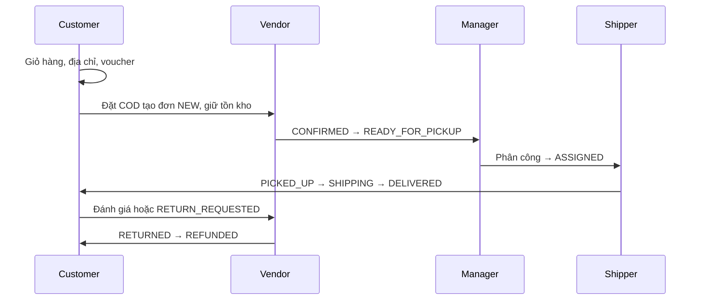

# Báo cáo Người 3 — Quản trị và tích hợp StarShop

Ngày cập nhật: 12/10/2026. Nhánh: `feature/manager-admin`.

## 1. Phạm vi và hiện trạng

StarShop là hệ thống bán hoa nhiều cửa hàng. Người 1 phụ trách Guest/User; Người 2 phụ trách Vendor/Shipper; Người 3 phụ trách Manager/Admin và tích hợp, bảo mật, kiểm thử.

Đã tích hợp lịch sử của Người 2 từ develop (`97d725a`) và Người 1 từ feature/customer (`72a7661`, ngày 10/10). Giữ lịch sử commit từng thành viên. Các thay đổi tích hợp có nội dung commit riêng.

## 2. Kiến trúc

Luồng quản trị: JSP Bootstrap → Controller → Service có transaction/validation → Repository JPA → SQL Server.
Package chung: `vn.iotstar.starshop`; WAR hỗ trợ JSP/JSTL.
SiteMesh 3.2.1 trang trí khu vực Manager; CSV, API và WebSocket được xử lý riêng.

Các bảng dùng lại: users, roles, user_roles, shops, categories, products, commissions, promotions, orders, order_details, shipping_providers, shipper_assignments, notifications.
Bảng mới `product_moderations` lưu ID sản phẩm, cờ khóa, lý do, người xử lý và thời gian. Không đổi enum ProductStatus/OrderStatus của nhóm.

## 3. Chức năng và quy tắc

| Chức năng | Đường dẫn | Quy tắc chính |
|---|---|---|
| Dashboard | /manager | Tổng User/Shop/Product/Category; đơn và doanh thu tháng hiện tại |
| User | /manager/users | Tìm tên/email, phân trang, xem chi tiết, khóa/mở khóa |
| Cấp vai trò | /manager/users/{id}/roles | Chỉ Admin cấp/gỡ Manager/Shipper; Vendor qua duyệt shop |
| Shop | /manager/shops | Duyệt/từ chối/khóa/mở; xem chi tiết |
| Danh mục | /manager/categories | Thêm/sửa/bật/tắt, kiểm tra dữ liệu |
| Kiểm duyệt | /manager/products | Tìm tên, lọc shop/trạng thái; khóa có lý do 10–500 ký tự |
| Commission | /manager/shops/{id}/commission | 0–100%, 2 chữ số thập phân; lưu lịch sử |
| Voucher SYSTEM | /manager/promotions | Tạo/sửa/bật/tắt; %, số tiền, miễn vận chuyển |
| Nhà vận chuyển | /manager/shipping-providers | Phí không âm, thời gian 1–365 ngày, bật/tắt |
| Đơn/phân công | /manager/orders | Phân trang/lọc; chỉ phân công READY_FOR_PICKUP chưa có Shipper |
| Báo cáo | /manager/reports | Khoảng ngày, trạng thái, doanh thu, CSV |
| Thông báo | /notifications | Chỉ xem/đánh dấu thông báo của chính mình |

Không tự khóa tài khoản; không mở khóa INACTIVE thành ACTIVE; Manager không quản lý tài khoản Manager/Admin; chức năng khóa không khóa Admin.
Admin có các chức năng Manager và thêm quyền cấp vai trò vận hành. Manager được quản lý nghiệp vụ toàn hệ thống; chưa có mô hình gán riêng Manager cho từng shop.

Sản phẩm bị kiểm duyệt chuyển INACTIVE. Vendor không thể sửa/bật lại khi cờ kiểm duyệt còn khóa. Mở kiểm duyệt vẫn giữ INACTIVE để Vendor tự kiểm tra và bật sản phẩm.

Voucher SYSTEM không gắn shop; mã duy nhất không phân biệt hoa thường; phần trăm tối đa 100; thời gian kết thúc sau bắt đầu. Service Customer dùng lại bảng promotion để tính/phân bổ giảm giá và trừ lượt trong transaction. Không sửa voucher SHOP ở màn hình SYSTEM.

Phân công khóa bản ghi đơn để chặn trùng, yêu cầu Shipper ACTIVE có vai trò SHIPPER và nhà vận chuyển hoạt động. Giữ số tiền/phí giao của đơn đã đặt.

Doanh thu là tổng totalAmount của đơn hiện ở DELIVERED trong khoảng thời gian tạo đơn, gồm phí vận chuyển và trừ giảm giá. Không phải lợi nhuận hay sổ kế toán phí ứng dụng. Số User/Shop/Product là tổng hiện tại toàn hệ thống.

## 4. Luồng tích hợp

Các lỗi tích hợp được sửa:
- Custom login dùng email thống nhất giữa Customer và test Manager.
- Vendor hủy đơn/nhận hàng trả dùng service hoàn tồn kho, giảm soldCount và khóa bản ghi sản phẩm.
- Vendor cập nhật đơn dùng khóa bản ghi để không đua trạng thái với Customer/Shipper.
- Shipper giao COD thành công cập nhật paymentStatus=PAID.
- SQL Server dùng filtered unique index cho phone khác NULL; cho phép nhiều tài khoản chưa nhập phone. Migration có transaction, giữ dữ liệu và ràng buộc email.
- Test hiển thị tiền chấp nhận dấu phân nhóm của bản JDK, vẫn kiểm tra số tiền và voucher.

## 5. Bảo mật, JWT và WebSocket

Spring Security có hai filter chain:
- Web JSP: form login email, BCrypt, CSRF cho các POST, kiểm tra URL theo role. Filter kiểm tra tài khoản bị khóa và hủy session ở request tiếp theo.
- API /api/**: stateless, Bearer JWT; không dùng session cookie nên không áp dụng CSRF cho API.

POST /api/auth/token nhận JSON email/password, trả access_token hiệu lực 15 phút; GET /api/me xem chủ thể/quyền; GET /api/manager/report chỉ cho Manager/Admin.
JWT ký HS256. Secret từ JWT_SECRET ít nhất 32 byte; nếu bỏ trống sinh khóa ngẫu nhiên khi khởi động, token cũ hết hiệu lực khi restart.
Decoder kiểm tra issuer, thời hạn, chữ ký. Converter đọc lại quyền/trạng thái từ database và dấu vân tay hash mật khẩu để token bị từ chối sau khóa tài khoản/đổi mật khẩu. Không ghi token hoặc secret vào log.

WebSocket /ws/notifications dùng principal của session đăng nhập và chỉ cho cùng origin. Server gửi sự kiện cập nhật riêng theo email, không gửi nội dung riêng tư qua broadcast và không nhận thao tác từ client. Thông báo được lưu database và chỉ gửi sau commit; mất kết nối vẫn đọc được lịch sử. Giao diện có badge số chưa đọc; trang thông báo cho đánh dấu đã đọc.

Tài liệu tham khảo: [Spring Security JWT](https://docs.spring.io/spring-security/reference/servlet/oauth2/resource-server/jwt.html), [Spring WebSocket](https://docs.spring.io/spring-framework/reference/web/websocket.html), [SiteMesh](https://github.com/sitemesh/sitemesh3).

## 6. Kiểm thử và giới hạn xác minh

Lệnh: `mvn verify`.

Kết quả ngày 12/10/2026: 24 test, 0 failure, 0 error; tạo thành công `target/starshop-1.0.war`.

Các test bao gồm:
- Customer → Vendor → Manager → Shipper → Customer; voucher SYSTEM, COD, lịch sử đơn, đánh giá, trả hàng và hoàn tiền.
- Kiểm duyệt sản phẩm không bị Vendor vượt qua.
- User không truy cập quản trị; Manager không cấp vai trò; POST web cần CSRF.
- JWT token thật: cấp token, phân quyền, token giả/sửa chữ ký, tài khoản khóa, đổi mật khẩu.
- HTTP/Tomcat thật: login và render JSP quản trị có dữ liệu; SiteMesh decorator.
- WebSocket thật: handshake sau login, nhận sự kiện commit, chặn origin ngoài hệ thống.
- Thông báo không thể đánh dấu của người khác.
- SQL Server: migration filtered phone index chạy trên database thử riêng, kiểm tra nhiều NULL và chặn trùng số đã nhập, chạy lại an toàn; database thử đã dọn.

Luồng nghiệp vụ tự động dùng H2 ở chế độ MSSQLServer. Máy build hiện có Java 22; Maven target Java 17.
Chưa chạy toàn ứng dụng qua JDBC SQL Server hoặc gửi email/upload Cloudinary thật do chưa có biến môi trường kết nối/dịch vụ.
Bản push nhánh cá nhân chưa phải bản demo main. Merge develop/main cần nhóm kiểm tra cấu hình và demo trên dữ liệu thật.

## 7. Hướng dẫn demo

1. Cấu hình DB_URL, DB_USERNAME, DB_PASSWORD cho SQL Server; migration phone cần quyền sửa index trên dbo.users.
2. Cấu hình MAIL_HOST, MAIL_PORT, MAIL_USERNAME, MAIL_PASSWORD để OTP gửi thật.
3. Cấu hình CLOUDINARY_CLOUD_NAME, CLOUDINARY_API_KEY, CLOUDINARY_API_SECRET cho upload.
4. Đặt JWT_SECRET riêng khi triển khai. Không ghi khóa/mật khẩu thật vào source.
5. Có thể đặt BOOTSTRAP_ADMIN_EMAIL và BOOTSTRAP_ADMIN_PASSWORD (12–72 ký tự) để tạo Admin đầu tiên. Không nâng quyền email của tài khoản User đã có; không thay mật khẩu Admin đã có. Xóa hai biến bootstrap sau khi tạo.
6. Build `mvn verify`, chạy WAR, đăng nhập /login; Admin tạo tài khoản Shipper/Manager từ User đã kích hoạt; duyệt shop, cấu hình vận chuyển và voucher.
7. Dùng các vai trò riêng để demo toàn luồng; giới thiệu phân quyền, SQL transaction, báo cáo và thông báo.

## 8. Câu hỏi báo cáo gợi ý

- Vì sao không sửa tổng tiền khi phân công? Đây là số tiền khách đã xác nhận lúc đặt.
- Vì sao cần pessimistic lock? Chặn cập nhật/phân công trùng khi hai request xử lý cùng bản ghi.
- Vì sao giữ sản phẩm ẩn sau mở kiểm duyệt? Người bán cần sửa/kiểm tra nội dung trước khi bán lại.
- Vì sao JWT không thay form login JSP? API dùng token; form web cần session và CSRF riêng.
- Vì sao thông báo phát sau commit? Tránh báo đơn/thay đổi chưa được lưu thành công.
- Vì sao filtered index cho phone? SQL Server UNIQUE thông thường chỉ cho một NULL; đăng ký bằng email chưa bắt buộc phone.
