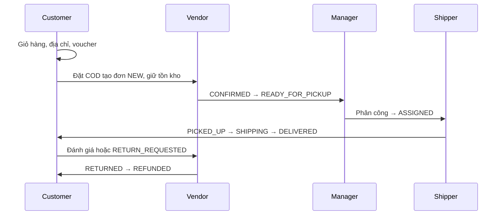

# Báo cáo Người 3 — Quản trị và tích hợp StarShop

Ngày cập nhật: 28/10/2026. Nhánh: `feature/manager-admin`.

## 1. Phạm vi và hiện trạng

StarShop là hệ thống bán hoa nhiều cửa hàng. Người 1 phụ trách Guest/User; Người 2 phụ trách Vendor/Shipper; Người 3 phụ trách Manager/Admin và tích hợp, bảo mật, kiểm thử.

Đã tích hợp lịch sử của Người 2 từ develop (`97d725a`) và Người 1 từ feature/customer (`72a7661`, ngày 10/10). Giữ lịch sử commit từng thành viên. Các thay đổi tích hợp có nội dung commit riêng.

## 2. Kiến trúc

Luồng quản trị: JSP Bootstrap → Controller → Service có transaction/validation → Repository JPA → SQL Server.
Package chung: `vn.iotstar.starshop`; WAR hỗ trợ JSP/JSTL.
SiteMesh 3.2.1 trang trí khu vực Manager; CSV, API và WebSocket được xử lý riêng.

Các bảng dùng lại: users, roles, user_roles, shops, categories, products, commissions, promotions, orders, order_details, shipping_providers, shipper_assignments, notifications.
Bảng mới `product_moderations` lưu ID sản phẩm, cờ khóa, lý do, người xử lý và thời gian. Không đổi enum ProductStatus/OrderStatus của nhóm.

## 3. Chức năng và quy tắc

| Chức năng | Đường dẫn | Quy tắc chính |
|---|---|---|
| Dashboard | /manager | Tổng User/Shop/Product/Category; đơn và doanh thu tháng hiện tại |
| User | /manager/users | Chỉ Admin tìm tên/email, phân trang, xem chi tiết, khóa/mở khóa |
| Cấp vai trò | /manager/users/{id}/roles | Chỉ Admin cấp/gỡ Manager/Shipper; Vendor qua duyệt shop |
| Shop | /manager/shops | Admin duyệt/từ chối/khóa/mở; Manager xem shop được phân công |
| Danh mục | /manager/categories | Chỉ Admin thêm/sửa/bật/tắt |
| Kiểm duyệt | /manager/products | Tìm tên, lọc shop/trạng thái; khóa có lý do 10–500 ký tự |
| Commission | /manager/shops/{id}/commission | Chỉ Admin sửa tỷ lệ 0–100%, lưu lịch sử; Manager chỉ xem tỷ lệ của shop được giao |
| Voucher SYSTEM | /manager/promotions | Chỉ Admin tạo/sửa/bật/tắt; %, số tiền, miễn vận chuyển |
| Nhà vận chuyển | /manager/shipping-providers | Chỉ Admin sửa danh sách và biểu phí chung; Manager chọn nhà vận chuyển có sẵn khi phân công đơn |
| Đơn/phân công | /manager/orders | Phân trang/lọc; chỉ phân công READY_FOR_PICKUP chưa có Shipper |
| Báo cáo | /manager/reports | Khoảng ngày, trạng thái, doanh thu, CSV |
| Thông báo | /notifications | Chỉ xem/đánh dấu thông báo của chính mình |

Chỉ Admin quản lý tài khoản; không tự khóa tài khoản, không mở khóa INACTIVE thành ACTIVE; chức năng khóa không khóa Admin.
Admin quản lý toàn hệ thống và cấp vai trò vận hành. Manager chỉ quản lý các shop được Admin phân công; service giới hạn cả truy cập trực tiếp qua ID.

Sản phẩm bị kiểm duyệt chuyển INACTIVE. Vendor không thể sửa/bật lại khi cờ kiểm duyệt còn khóa. Mở kiểm duyệt vẫn giữ INACTIVE để Vendor tự kiểm tra và bật sản phẩm.

Voucher SYSTEM không gắn shop; mã duy nhất không phân biệt hoa thường; phần trăm tối đa 100; thời gian kết thúc sau bắt đầu. Service Customer dùng lại bảng promotion để tính/phân bổ giảm giá và trừ lượt trong transaction. Không sửa voucher SHOP ở màn hình SYSTEM.

Phân công khóa bản ghi đơn để chặn trùng, yêu cầu Shipper ACTIVE có vai trò SHIPPER và nhà vận chuyển hoạt động. Giữ số tiền/phí giao của đơn đã đặt.

Doanh thu là tổng totalAmount của đơn hiện ở DELIVERED trong khoảng thời gian tạo đơn, gồm phí vận chuyển và trừ giảm giá. Không phải lợi nhuận hay sổ kế toán phí ứng dụng. Số User/Shop/Product là tổng hiện tại toàn hệ thống.

## 4. Luồng tích hợp

Các lỗi tích hợp được sửa:
- Custom login dùng email thống nhất giữa Customer và test Manager.
- Vendor hủy đơn/nhận hàng trả dùng service hoàn tồn kho, giảm soldCount và khóa bản ghi sản phẩm.
- Vendor cập nhật đơn dùng khóa bản ghi để không đua trạng thái với Customer/Shipper.
- Shipper giao COD thành công cập nhật paymentStatus=PAID.
- SQL Server dùng filtered unique index cho phone khác NULL; cho phép nhiều tài khoản chưa nhập phone. Migration có transaction, giữ dữ liệu và ràng buộc email.
- Test hiển thị tiền chấp nhận dấu phân nhóm của bản JDK, vẫn kiểm tra số tiền và voucher.

## 5. Bảo mật, JWT và WebSocket

Spring Security có hai filter chain:
- Web JSP: form login email, BCrypt, CSRF cho các POST, kiểm tra URL theo role. Filter kiểm tra tài khoản bị khóa và hủy session ở request tiếp theo.
- API /api/**: stateless, Bearer JWT; không dùng session cookie nên không áp dụng CSRF cho API.

POST /api/auth/token nhận JSON email/password, trả access_token hiệu lực 15 phút; GET /api/me xem chủ thể/quyền; GET /api/manager/report chỉ cho Manager/Admin.
JWT ký HS256. Secret từ JWT_SECRET ít nhất 32 byte; nếu bỏ trống sinh khóa ngẫu nhiên khi khởi động, token cũ hết hiệu lực khi restart.
Decoder kiểm tra issuer, thời hạn, chữ ký. Converter đọc lại quyền/trạng thái từ database và dấu vân tay hash mật khẩu để token bị từ chối sau khóa tài khoản/đổi mật khẩu. Không ghi token hoặc secret vào log.

WebSocket /ws/notifications dùng principal của session đăng nhập và chỉ cho cùng origin. Server gửi sự kiện cập nhật riêng theo email, không gửi nội dung riêng tư qua broadcast và không nhận thao tác từ client. Thông báo được lưu database và chỉ gửi sau commit; mất kết nối vẫn đọc được lịch sử. Giao diện có badge số chưa đọc; trang thông báo cho đánh dấu đã đọc.

Tài liệu tham khảo: [Spring Security JWT](https://docs.spring.io/spring-security/reference/servlet/oauth2/resource-server/jwt.html), [Spring WebSocket](https://docs.spring.io/spring-framework/reference/web/websocket.html), [SiteMesh](https://github.com/sitemesh/sitemesh3).

## 6. Kiểm thử và giới hạn xác minh

Lệnh: `mvn verify`.

Kết quả ngày 12/10/2026: 24 test, 0 failure, 0 error; tạo thành công `target/starshop-1.0.war`.

Các test bao gồm:
- Customer → Vendor → Manager → Shipper → Customer; voucher SYSTEM, COD, lịch sử đơn, đánh giá, trả hàng và hoàn tiền.
- Kiểm duyệt sản phẩm không bị Vendor vượt qua.
- User không truy cập quản trị; Manager không cấp vai trò; POST web cần CSRF.
- JWT token thật: cấp token, phân quyền, token giả/sửa chữ ký, tài khoản khóa, đổi mật khẩu.
- HTTP/Tomcat thật: login và render JSP quản trị có dữ liệu; SiteMesh decorator.
- WebSocket thật: handshake sau login, nhận sự kiện commit, chặn origin ngoài hệ thống.
- Thông báo không thể đánh dấu của người khác.
- SQL Server: migration filtered phone index chạy trên database thử riêng, kiểm tra nhiều NULL và chặn trùng số đã nhập, chạy lại an toàn; database thử đã dọn.

Luồng nghiệp vụ tự động dùng H2 ở chế độ MSSQLServer. Máy build hiện có Java 22; Maven target Java 17.
Ứng dụng đã chạy trên SQL Server. SMTP đã xác thực và gửi email tới chủ tài khoản; luồng nhập OTP thật cần người dùng nghiệm thu. Service Cloudinary đã upload ảnh và video thật thành công.
Bản push nhánh cá nhân chưa phải bản demo main. Merge develop/main cần nhóm kiểm tra cấu hình và demo trên dữ liệu thật.

## 7. Hướng dẫn demo

1. Cấu hình DB_URL, DB_USERNAME, DB_PASSWORD cho SQL Server; migration phone cần quyền sửa index trên dbo.users.
2. Cấu hình MAIL_HOST, MAIL_PORT, MAIL_USERNAME, MAIL_PASSWORD để OTP gửi thật.
3. Cấu hình CLOUDINARY_CLOUD_NAME, CLOUDINARY_API_KEY, CLOUDINARY_API_SECRET cho upload.
4. Đặt JWT_SECRET riêng khi triển khai. Không ghi khóa/mật khẩu thật vào source.
5. Có thể đặt BOOTSTRAP_ADMIN_EMAIL và BOOTSTRAP_ADMIN_PASSWORD (12–72 ký tự) để tạo Admin đầu tiên. Không nâng quyền email của tài khoản User đã có; không thay mật khẩu Admin đã có. Xóa hai biến bootstrap sau khi tạo.
6. Build `mvn verify`, chạy WAR, đăng nhập /login; Admin tạo tài khoản Shipper/Manager từ User đã kích hoạt; duyệt shop, cấu hình vận chuyển và voucher.
7. Dùng các vai trò riêng để demo toàn luồng; giới thiệu phân quyền, SQL transaction, báo cáo và thông báo.

## 8. Câu hỏi báo cáo gợi ý

- Vì sao không sửa tổng tiền khi phân công? Đây là số tiền khách đã xác nhận lúc đặt.
- Vì sao cần pessimistic lock? Chặn cập nhật/phân công trùng khi hai request xử lý cùng bản ghi.
- Vì sao giữ sản phẩm ẩn sau mở kiểm duyệt? Người bán cần sửa/kiểm tra nội dung trước khi bán lại.
- Vì sao JWT không thay form login JSP? API dùng token; form web cần session và CSRF riêng.
- Vì sao thông báo phát sau commit? Tránh báo đơn/thay đổi chưa được lưu thành công.
- Vì sao filtered index cho phone? SQL Server UNIQUE thông thường chỉ cho một NULL; đăng ký bằng email chưa bắt buộc phone.

## 9. Bổ sung hoàn thiện ngày 16/10/2026

- Tạo database riêng `StarShopLocal` trên SQL Server của máy phát triển; chạy toàn ứng dụng bằng Microsoft JDBC thay H2 preview. Dữ liệu 50 sản phẩm được lưu trên SQL Server và nạp lại không trùng.
- Thống nhất giao diện qua Bootswatch Litera 5.3.3 và các tag `theme.tag`, `workspaceNav.tag`. CSS/Bootstrap JS/giấy phép được lưu trong project; các khu vực vẫn có bố cục theo tác vụ.
- Bổ sung trường `Shop.manager`, Admin phân công/gỡ Manager từ chi tiết shop. Manager chỉ truy cập cửa hàng, sản phẩm, đơn hàng và doanh thu thuộc shop được giao. Các API service kiểm tra cả truy cập trực tiếp bằng ID; không chỉ ẩn nút giao diện.
- Có `ManagerShopScopeTests` kiểm tra đọc/sửa ngoài phạm vi, phân công chỉ dành Admin, báo cáo giới hạn theo Manager và Admin vẫn xem được toàn hệ thống.
- Sửa `/vendor` chuyển tới dashboard, thêm liên kết theo vai trò từ tài khoản mua hàng và điều hướng workspace.
- Tách SMTP/Cloudinary vào `.local/services.properties`, loại khỏi Git; ví dụ công khai không chứa khóa. Đã cấu hình riêng trên máy; SMTP và upload Cloudinary đã được kiểm tra kết nối thật.
- Bổ sung hướng dẫn `van-hanh-local.md`, scripts thiết lập/chạy/kiểm tra local và báo cáo nội dung cho Người 1/Người 2. Báo cáo các thành viên cần điền họ tên, MSSV và ảnh minh chứng trước khi nộp.

Các nhận định “chưa chạy toàn ứng dụng qua SQL Server” ở phần ghi nhận đợt trước được cập nhật bởi phần này. SMTP và Cloudinary đã được cấu hình và kiểm tra kết nối thật ngày 26/10/2026.

## 10. Dữ liệu và nghiệm thu theo vai trò ngày 23/10/2026

Đã bổ sung ba cửa hàng, phân bổ 50 sản phẩm, tài khoản Vendor/Manager theo chi nhánh, Shipper và khách hàng có nhiều địa chỉ. Hai nhà vận chuyển, ba voucher, chiết khấu shop và 13 đơn đủ các trạng thái được lưu trên SQL Server. Đơn tạo qua service, kiểm tra tách giỏ hai shop, giao hàng, đánh giá và hoàn trả; không gọi thanh toán/giao hàng ngoài ứng dụng.

Đã đăng nhập từng vai trò trên ứng dụng SQL Server, kiểm tra các trang và giới hạn chi nhánh Manager. Full build có 44 kiểm thử đạt. Sau khi tắt khởi tạo và mở lại, dữ liệu vẫn giữ nguyên. Xem `du-lieu-van-hanh.md`; thông tin đăng nhập được giữ riêng ngoài Git.

## 11. Thanh toán và dịch vụ ngày 26/10/2026

- VNPAY Sandbox: đã thanh toán bằng thẻ thử NCB. Đơn #18 được tự động cập nhật PAID sau khi xác minh chữ ký, số tiền, mã merchant và trạng thái thành công trên Return URL. IPN và Return dùng chung cơ chế cập nhật chống xử lý lặp. Chưa xác nhận IPN công khai đã được VNPAY đăng ký và gọi thực tế.
- Cloudinary: đã upload đủ 50 ảnh sản phẩm và một video kiểm tra bằng service Java. Kiểm tra 50/50 URL ảnh hợp lệ, cập nhật SQL Server và danh mục trong Git. Không đưa khóa vào repository.
- SMTP: xác thực và gửi email thành công tới chủ tài khoản. Luồng nhận và nhập OTP đăng ký/quên mật khẩu thật cần chủ email nghiệm thu.
- `mvn verify`: 69 kiểm thử, 0 thất bại, 0 lỗi. Đã đóng gói WAR và mở lại ứng dụng SQL Server.
- Báo cáo các thành viên cần bổ sung họ tên, MSSV và ảnh minh chứng cá nhân trước khi nộp.

## 12. Phân quyền quản lý chi nhánh ngày 28/10/2026

Quy ước vận hành: Manager là quản lý chi nhánh, Admin là quản trị toàn hệ thống. Quyền thiết lập chính sách chung được tách khỏi Manager để phù hợp phạm vi shop được giao. Khi đối chiếu đề có mô tả quyền Manager và Admin gần nhau, nhóm cần nêu rõ quy ước này.

Manager quản lý sản phẩm, xem đơn và phân công giao hàng, xem báo cáo và tỷ lệ chiết khấu trong các shop được phân công. Manager không đổi chiết khấu app, duyệt/khóa shop, quản lý tài khoản, danh mục chung, voucher hệ thống hoặc biểu phí vận chuyển. Voucher SHOP vẫn do Vendor phụ trách.

Menu và biểu mẫu được tách theo vai trò; URL và service cùng kiểm tra quyền. Báo cáo Manager chỉ đếm khách đã đặt hàng tại shop được giao trong khoảng ngày chọn, không dùng tổng tài khoản toàn hệ thống.

Manager không được mở danh sách tài khoản hoặc hồ sơ Manager khác, kể cả truy cập trực tiếp bằng ID hoặc tìm email. Chỉ Admin xem và quản lý hồ sơ nhân sự toàn hệ thống. Manager vẫn truy cập trang cá nhân của chính mình và thông tin cần thiết để xử lý đơn thuộc shop được giao.
